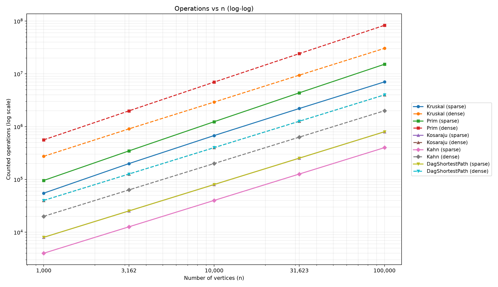
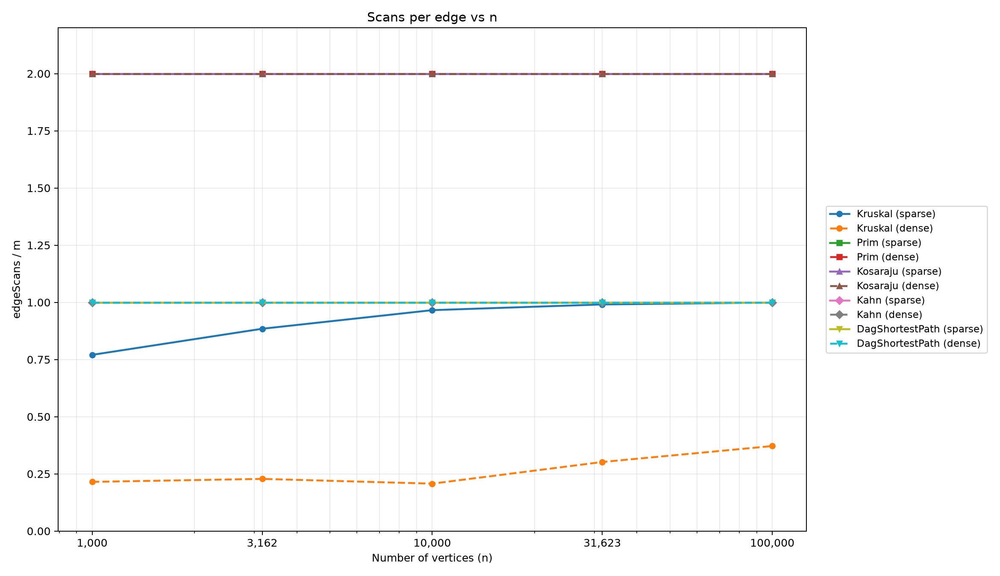
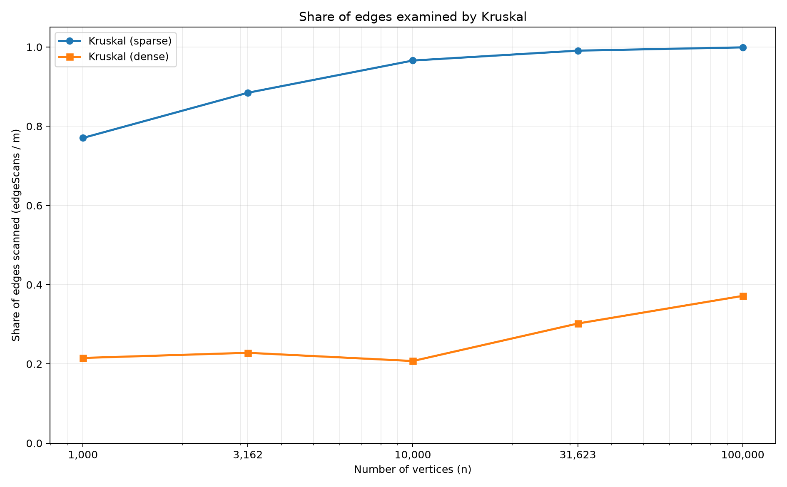

# Assignment 3 Report: DSU, MST, SCC and Shortest Paths

**Course:** Design and Analysis of Algorithms  
**Student:** Irangait Yerassyl  
**Group:** SE-2523  
**Implementation:** Java 17, Maven, JUnit 5
**GitHub Repository:** [Yerassyp/DAA_Assignment3](https://github.com/Yerassyp/DAA_Assignment3)

## 1. Goal and experiment setup

This project implements one adjacency-list `Graph` class for directed and undirected weighted graphs, a Disjoint Set Union (DSU), Kruskal, Prim, iterative Kosaraju, Kahn topological sorting, and DAG shortest paths. The goal is to test correctness and compare the algorithms using operation counters rather than only execution time. The code accepts self-loops, parallel edges, isolated vertices, and disconnected graphs. Both MST algorithms return a minimum spanning forest when the graph is disconnected.

The benchmark uses the five vertex counts **1,000; 3,162; 10,000; 31,623; and 100,000**, with **m = 4n** (sparse) and **m = 20n** (dense). For every size and density, it generates an undirected graph, a directed graph, and a DAG using the exact algorithm with `new Random(42)`. Five algorithms are measured separately on each of the ten configurations: **50 CSV data rows** in total. Generated benchmark edge weights are positive (1 to 1,000); negative-weight handling is checked separately in JUnit. Each algorithm runs five times on its generated graph, and `time_ms` is the median of these runs. Results are stored in `results/results.csv`.

## 2. Correctness and reference checks

All **30 reference values** match the assignment table: ten MST weights, ten SCC counts, and ten sums of DAG distances. Kruskal and Prim agree on the MST weight for every benchmark graph. The most demanding configuration, **n = 100,000, m = 2,000,000**, gives **MST = 3,056,681**, **SCC = 1**, and **DAG distance sum = 23,512,087**. The full Maven verification passes **70 JUnit tests**. These include 100 connected random graphs for MST agreement, brute-force SCC using forward and backward BFS, Bellman-Ford checks with negative weights, cycle detection, and iterative DFS stack-safety tests on 100,000 vertices.

## 3. Complexity table

Here, **V** is the number of vertices, **E** is the number of edges, and **α(V)** is the inverse Ackermann function. The time for DSU operations is amortized; the DSU arrays themselves need O(V) storage.

| Algorithm | Time | Extra space | Justification |
|---|---|---|---|
| DSU `find` | O(α(V)) amortized | O(1) per call | Path compression shortens the paths to the representative. |
| DSU `union` | O(α(V)) amortized | O(1) per call | Two finds plus union by rank keep trees shallow. |
| Kruskal | O(V + E log E + Eα(V)) | O(V + E) | Initialize DSU, sort edges, then accept safe edges. |
| Lazy Prim | O(V + E log E) | O(V + E) | The priority queue can store O(E) candidate edges. |
| Kosaraju | O(V + E) | O(V + E) | Two iterative DFS passes plus the reversed graph. |
| Kahn | O(V + E) | O(V) | Each vertex leaves the queue once; each edge is processed once. |
| DAG shortest paths | O(V + E) | O(V) | Topological sorting followed by one pass of relaxations. |

## 4. Operation counters versus formulas

The counters are collected **inside the algorithms**. For Prim, each undirected edge is represented in two adjacency lists, so `edgeScans/m = 2.000`. Kosaraju performs one forward and one reversed DFS, so its ratio is also `2.000`. Kahn and DAG relaxation scan each directed edge once, giving `edgeScans/m = 1.000`. These ratios hold for all five sizes and both densities. For Kosaraju, the alternative ratio `edgeScans/(V+E)` is **1.600** in sparse graphs and about **1.905** in dense graphs, constant within each density.

Kruskal behaves differently because it stops scanning after all vertices are connected. Its `dsuOps` counts find calls and successful unions. For these connected generated graphs, the measured counters satisfy **`dsuOps = 2 × edgeScans + 3 × (V − 1)`** exactly. The table shows representative values from the CSV. The final column divides Kruskal's sorting comparisons by **E log₂(E)**.

| n | Density | Kruskal edgeScans/E | Kruskal dsuOps/E | Comparisons/(E log₂ E) |
|---:|---|---:|---:|---:|
| 1,000 | Sparse | 0.771 | 2.290 | 0.891 |
| 10,000 | Sparse | 0.966 | 2.682 | 0.869 |
| 100,000 | Sparse | 0.999 | 2.748 | 0.745 |
| 1,000 | Dense | 0.215 | 0.580 | 0.903 |
| 10,000 | Dense | 0.207 | 0.565 | 0.784 |
| 100,000 | Dense | 0.372 | 0.894 | 0.666 |

The ratios for full edge traversals remain constant as n increases. Kruskal's edge share is not constant because the stopping point depends on connectivity and edge weights. The comparison-to-`E log E` ratios stay bounded; they are not expected to be exactly equal for every graph.

## 5. Correctness arguments

### Cut property: why Kruskal and Prim are correct

For any cut that does not cross already chosen forest edges, let **e** be a lightest edge crossing it. If some minimum spanning tree does not contain **e**, adding **e** creates a cycle. That cycle has another edge **f** crossing the same cut. Because **e** is lightest, replacing **f** with **e** cannot increase the total weight. Therefore, some minimum spanning tree contains **e**, and choosing it is safe. Kruskal uses this rule when it picks the next lowest-weight edge joining two different DSU components. Prim uses the same rule when it picks the lightest edge from the visited set to an unvisited vertex. The argument also applies separately to each component of a disconnected graph, producing a minimum spanning forest.

### Induction over topological order: why DAG relaxation works

A topological order places every predecessor of a vertex before that vertex. Initially, all vertices with in-degree zero have distance zero, which is equivalent to a virtual super-source. Assume the distances of the already processed vertices are correct. Every path to the next vertex ends with an edge from an earlier predecessor, unless that vertex is a source. The algorithm has already processed each predecessor and relaxed its outgoing edges. Thus, the smallest candidate distance is the true shortest distance to the next vertex. By induction, one pass over the topological order gives correct distances for the whole DAG. Negative edge weights are safe in this method because a DAG has no directed cycles; general graphs with negative edges need a different algorithm, such as Bellman-Ford.

## 6. Plots and slope check

**Figure 1: Operations versus n.** The plotted count is `dsu_ops + edge_scans + comparisons`, used as an illustrative measure of recorded work, not a count of CPU instructions. The x- and y-axes are logarithmic.

**Figure 2: Scans per edge.** Flat lines at **2** for Prim and Kosaraju, and **1** for Kahn and DAG shortest paths, confirm the exact traversal invariants.

**Figure 3: Kruskal edge share.** On sparse graphs, Kruskal examines almost every edge for large n. For the largest dense graph, it examines **743,572 / 2,000,000 = 37.18%**, because the tree becomes connected before the sorted list ends.

The fitted log-log slopes of `edgeScans` against n are **1.000** for Prim, Kosaraju, Kahn, and DAG shortest paths, for both densities. Kruskal's edge-scan slopes are **1.055** (sparse) and **1.119** (dense), affected by early stopping. For the sorting `comparisons` counter, the slopes are **1.055** (sparse) and **1.016** (dense). The theoretical sorting upper bound is O(E log E), but these measured slopes are close to one over this finite input range; the data alone do not prove the logarithmic factor.

## 7. Which algorithm when?

| Situation | Choice | Reason |
|---|---|---|
| Sparse undirected graph given as an edge list | Kruskal | Sorting edges and DSU make cycle checking straightforward. |
| Dense undirected graph stored in adjacency lists | Prim | It grows a tree from neighboring edges, although heap costs may be high. |
| Disconnected undirected graph | Kruskal or Prim | Both return a minimum spanning forest. |
| Need to maintain connected groups through unions | DSU | Fast representative queries and merges. |
| Directed graph, cycles possible, need SCCs | Kosaraju | Finds mutually reachable groups with two DFS passes. |
| Directed dependency graph, need execution order | Kahn | Produces a valid order or reports a cycle. |
| DAG with weighted paths, even negative weights | DAG shortest paths | One relaxation pass after a topological sort. |
| General directed graph with negative edges | Bellman-Ford | Handles negative edges when shortest distances are well-defined. |

## 8. Time measurements and conclusion

Execution time depends on the computer, JIT compilation, JVM settings, garbage collection, and background programs. For the largest dense graph, the measured medians were **556.392 ms** for Kruskal, **1,925.388 ms** for Prim, **409.894 ms** for Kosaraju, **76.514 ms** for Kahn, and **107.297 ms** for DAG shortest paths. The timings help describe the experiment but are not the main evidence for complexity. The operation counters and exact reference checks are more reproducible across machines.

All required algorithms were implemented using Java 17 and standard collections, without external graph libraries. The benchmark reproduced every reference value, the JUnit tests checked correctness independently, and the counter measurements supported the expected traversal complexities. The CSV and three generated plots provide reproducible evidence for the analysis.